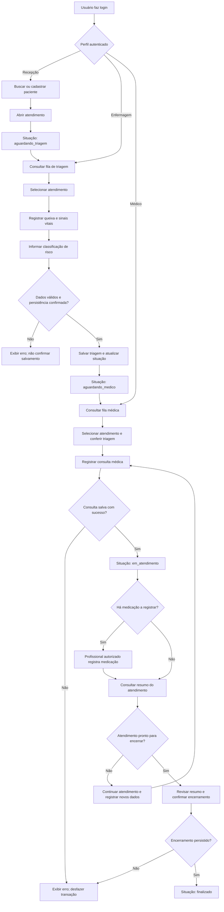

# Fluxo esperado do sistema completo

Este documento descreve o fluxo alvo do sistema quando todas as etapas previstas estiverem
implementadas, da recepção ao encerramento. Ele não define conduta clínica: a classificação de risco
é informada pela enfermagem após avaliação profissional.

## Visão geral

## Etapas detalhadas

1. **Autenticação:** a pessoa entra com login e senha. O backend identifica o perfil e autoriza cada
   operação; esconder uma área na interface não substitui essa verificação.
2. **Recepção:** busca um paciente existente ou cadastra um novo e abre um atendimento. O sistema
   associa a identidade da recepção autenticada e inicia o atendimento em `aguardando_triagem`.
3. **Enfermagem:** consulta os atendimentos pendentes, seleciona um e registra queixa, sinais vitais
   e classificação de risco. A classificação é uma escolha profissional, nunca calculada pelo
   sistema.
4. **Confirmação da triagem:** o backend valida e grava a triagem, muda a situação do atendimento
   para `aguardando_medico` na mesma transação e só confirma o salvamento depois do commit.
5. **Fila médica:** o médico consulta atendimentos em `aguardando_medico`. A ordem definida para a
   fila é FIFO por `triagens.criado_em` e, em caso de empate, por `atendimentos.id`; não há
   prioridade adicional por cor.
6. **Consulta médica:** o médico seleciona um atendimento e registra `registro_consulta`. O backend
   associa o médico autenticado e valida que paciente, atendimento e triagem selecionados
   correspondem entre si. A consulta é persistida e o atendimento passa para `em_atendimento`.
   Consultas adicionais podem ser registradas enquanto o atendimento continuar aberto.
7. **Medicações:** quando houver medicação a registrar, o profissional autorizado informa
   medicamento, dose, via e observações. O perfil autorizado deve ser definido formalmente e
   verificado no backend. Cada registro fica associado ao atendimento e ao profissional responsável.
8. **Resumo e encerramento:** o sistema apresenta os dados do paciente e do atendimento, triagem,
   consultas e medicações registradas. Após revisar e confirmar, o usuário autorizado encerra o
   atendimento; a situação passa para `finalizado` somente se a persistência for confirmada.

## Resultados alternativos e integridade

- **Fila vazia:** a interface informa que não há atendimentos disponíveis naquela fila.
- **Dados inválidos ou vínculos incompatíveis:** o backend rejeita a operação e apresenta uma
  mensagem clara; não retorna sucesso.
- **Falha de banco ou persistência:** alterações relacionadas são desfeitas quando aplicável e a
  interface não confirma o salvamento nem o encerramento.
- **Acesso por perfil não autorizado:** o backend recusa a operação.
- **Repetição de requisições:** operações de abertura e gravação devem evitar duplicidade conforme
  suas chaves e regras de idempotência.

## Regras clínicas e decisões pendentes

- O sistema não calcula a classificação de risco nem substitui a avaliação profissional.
- A fila médica segue FIFO; não deve ser introduzida prioridade por classificação sem requisito
  formal aprovado.
- O perfil autorizado para registrar medicações e o perfil autorizado para encerrar o atendimento
  devem ser confirmados nos requisitos do grupo antes de implementar o controle de acesso.
