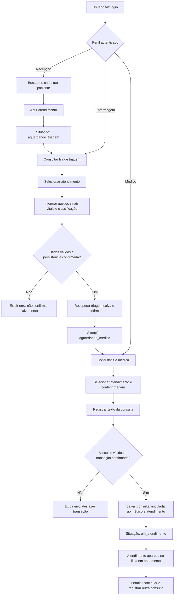

# Fluxo esperado do atendimento

Este fluxo reúne o comportamento esperado nas etapas atualmente implementadas. Ele não define
conduta clínica: a classificação de risco é informada pela enfermagem após avaliação profissional.

## Visão geral

## Etapas detalhadas

1. **Autenticação:** a pessoa entra com login e senha. O backend identifica o perfil e autoriza as
   operações; esconder uma área na interface não substitui essa verificação.
2. **Recepção:** busca um paciente existente ou cadastra um novo e abre um atendimento. O backend
   associa a identidade da recepção autenticada e inicia o atendimento em `aguardando_triagem`.
3. **Enfermagem:** consulta os atendimentos pendentes, seleciona um e registra queixa, sinais vitais
   e classificação. A classificação é uma escolha profissional, nunca calculada pelo sistema.
4. **Confirmação da triagem:** o backend valida os dados, grava a triagem e muda a situação do
   atendimento para `aguardando_medico` na mesma transação. Recupera o registro salvo antes do
   commit; a tela só apresenta sucesso e os dados confirmados depois que o commit termina.
5. **Fila médica:** o médico consulta atendimentos em `aguardando_medico`. A ordenação é FIFO por
   `triagens.criado_em` e, em empate, por `atendimentos.id`. Não há prioridade adicional por cor
   definida neste fluxo.
6. **Consulta médica:** o médico seleciona um atendimento e registra o campo textual
   `registro_consulta`. O backend usa o médico da sessão e valida que atendimento, paciente e
   triagem selecionados correspondem entre si. A gravação e a mudança para `em_atendimento` são
   confirmadas na mesma transação.
7. **Continuidade:** o atendimento em `em_atendimento` aparece em uma lista separada, inclusive
   depois de recarregar o painel. O médico pode continuar e criar outros registros para o mesmo
   atendimento. Esta etapa não finaliza o atendimento.

## Resultados alternativos

- **Fila vazia:** a interface informa que não há atendimentos aguardando triagem ou atendimento
  médico.
- **Dados inválidos ou vínculos incompatíveis:** o backend rejeita a operação e apresenta uma
  mensagem de erro; não retorna sucesso.
- **Falha de banco ou de persistência:** a transação é desfeita quando aplicável e a interface não
  confirma o salvamento.
- **Acesso por perfil não autorizado:** o backend recusa a operação.

## Fora do fluxo implementado

Registro e consulta de medicações, resumo pré-encerramento e finalização do atendimento permanecem
como etapas futuras. Os protótipos visuais dessas telas não representam persistência funcional.
