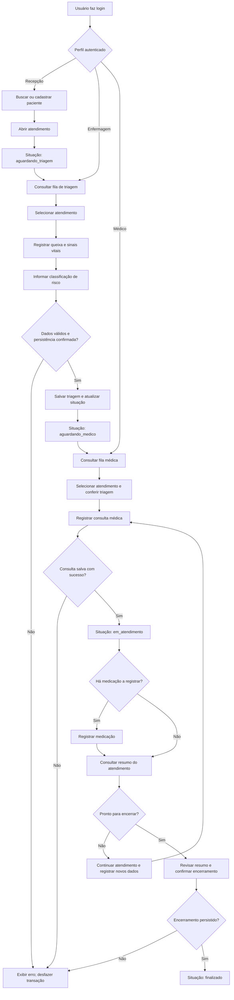

# Fluxo do sistema de atendimento

Este documento descreve o fluxo funcional disponível na versão atual, da recepção ao encerramento.
O sistema é uma demonstração acadêmica: não define conduta clínica, não calcula classificação de
risco e não substitui a avaliação profissional.

## Visão geral

## Etapas detalhadas

1. **Autenticação:** a pessoa entra com login e senha. O backend identifica o perfil e autoriza cada
   operação. Ocultar uma área na interface não substitui essa verificação. Os pedidos POST protegidos
   também precisam do token CSRF associado à sessão.
2. **Recepção:** busca um paciente existente ou cadastra um novo e abre um atendimento. O sistema
   associa a identidade da recepção autenticada e inicia o atendimento em `aguardando_triagem`.
3. **Fila de triagem:** a enfermagem consulta os atendimentos pendentes e seleciona um para registrar
   queixa, pressão, temperatura, frequência cardíaca, saturação e classificação de risco.
4. **Classificação:** a opção é informada pela enfermagem após avaliação profissional. O sistema
   registra a escolha; não classifica nem calcula risco.
5. **Confirmação da triagem:** o backend valida e grava a triagem, muda a situação do atendimento
   para `aguardando_medico` e recupera o registro para confirmação na mesma operação transacional.
   A interface só apresenta sucesso após a confirmação da persistência.
6. **Fila médica:** o médico consulta atendimentos em `aguardando_medico`. A fila apresenta dados do
   paciente, classificação, queixa, sinais vitais, data/hora e profissional responsável. A ordem é
   FIFO por `triagens.criado_em` e, em caso de empate, por `atendimentos.id`; a classificação não
   acrescenta prioridade à ordenação.
7. **Consulta médica:** o médico seleciona um atendimento e registra `registro_consulta`. O backend
   associa o médico autenticado, verifica que paciente e triagem selecionados pertencem ao
   atendimento e persiste a consulta. O estado passa a `em_atendimento`. Consultas adicionais podem
   ser registradas enquanto o atendimento estiver aberto.
8. **Medicações:** quando necessário, o perfil `medico` informa medicamento, dose, via e observações.
   O registro é associado ao atendimento e ao profissional autenticado e pode ser consultado durante
   o atendimento em andamento.
9. **Resumo:** a tela apresenta os dados do paciente e do atendimento, triagem, consultas e
   medicações. O resumo é montado com os registros existentes; não é salvo em uma tabela própria.
10. **Encerramento:** após revisar o resumo, o usuário autorizado confirma o encerramento. O backend
    exige situação `em_atendimento` e ao menos uma consulta médica registrada. A situação passa para
    `finalizado` somente depois da confirmação da persistência.

## Situações do atendimento

| Situação             | Significado                                                                |
| -------------------- | -------------------------------------------------------------------------- |
| `aguardando_triagem` | Atendimento aberto pela recepção e disponível para a enfermagem.           |
| `aguardando_medico`  | Triagem confirmada; atendimento disponível na fila médica.                 |
| `em_atendimento`     | Consulta iniciada; são permitidos novos registros de consulta e medicação. |
| `finalizado`         | Encerramento confirmado; o atendimento sai das filas em andamento.         |

## Resultados alternativos e integridade

- **Fila vazia:** a interface informa que não há atendimentos disponíveis naquela fila.
- **Dados inválidos ou vínculos incompatíveis:** o backend rejeita a operação e retorna erro em vez
  de confirmar o salvamento.
- **Falha de banco ou persistência:** alterações transacionais são desfeitas quando aplicável; a
  interface não confirma a operação.
- **Perfil não autorizado:** o backend recusa a operação, mesmo que a requisição seja enviada fora
  da interface.
- **Atendimento em estado incompatível:** triagem, consulta, medicação ou encerramento são recusados
  quando o estado não permite aquela ação.
- **Repetição do encerramento:** solicitar novamente o encerramento de um atendimento já
  `finalizado` retorna a situação final sem executar outra atualização.
- **Tentativas repetidas de abertura/cadastro:** as chaves de tentativa ajudam a reconhecer
  repetições; restrições do banco protegem os vínculos e evitam determinados registros duplicados.

## Regras clínicas e decisões pendentes

- A classificação é informada pela enfermagem e não substitui avaliação clínica.
- A fila médica segue FIFO; não deve ser introduzida prioridade por classificação sem requisito
  formal aprovado.
- O perfil autorizado para registrar medicações e encerrar atendimentos está configurado como
  `medico`, mas essa regra ainda precisa de confirmação formal do grupo.
- Os perfis e dados de demonstração são fictícios. Use apenas dados fictícios em todas as telas e
  scripts.
- O projeto não é uma ferramenta clínica validada e não deve ser usado para atendimento real ou
  produção.
