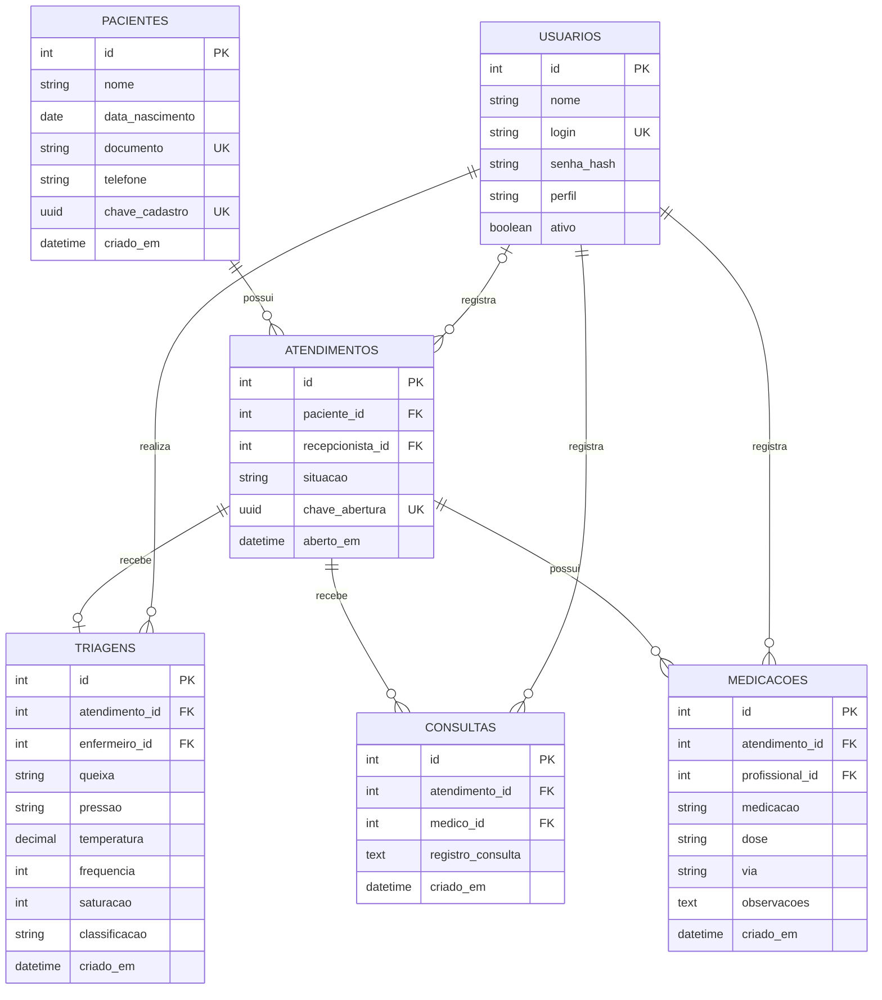

# MER esperado — modelo do sistema completo

Este documento descreve o modelo conceitual esperado quando o fluxo completo do sistema estiver
implementado. Ele inclui as entidades previstas para consulta médica e medicações, mesmo que os
schemas físicos atuais ainda precisem ser alinhados a esse modelo. Os campos de `CONSULTAS` e
`MEDICACOES` seguem os diagramas e requisitos fornecidos; confirme-os com a especificação oficial
antes de usá-los como migração de banco.

## Diagrama

## Entidades e regras esperadas

### USUARIOS

Armazena as contas e os perfis de acesso.

- `id`: chave primária.
- `nome`, `login`, `senha_hash`, `perfil` e `ativo`.
- `login` é único; a senha deve ser armazenada como hash seguro, usando `scrypt` conforme a
  implementação existente.
- Os perfis previstos são `recepcao`, `enfermagem` e `medico`.
- A autorização de cada operação deve ser validada no backend.

### PACIENTES

Armazena os dados cadastrais do paciente.

- `id`: chave primária.
- `nome`, `data_nascimento`, `documento`, `telefone`, `chave_cadastro` e `criado_em`.
- `documento` contém os 11 dígitos do CPF e é único; `telefone` é opcional.
- `chave_cadastro` identifica a tentativa de cadastro e evita duplicação por repetição.

### ATENDIMENTOS

Representa uma passagem do paciente pelo fluxo de atendimento.

- `id`: chave primária; `paciente_id`: referência obrigatória a `PACIENTES`.
- `recepcionista_id`: referência opcional a `USUARIOS`.
- `situacao`: `aguardando_triagem`, `aguardando_medico`, `em_atendimento` ou `finalizado`.
- `chave_abertura`: identificador único da tentativa; `aberto_em`: data e hora de abertura.
- Cada atendimento pertence a um paciente. Um paciente pode ter vários atendimentos ao longo do
  tempo.
- O encerramento é registrado pela situação `finalizado`; não exige uma entidade separada.

### TRIAGENS

Registra a avaliação de enfermagem vinculada ao atendimento.

- `id`: chave primária; `atendimento_id`: referência única a `ATENDIMENTOS`.
- `enfermeiro_id`: referência a `USUARIOS`.
- `queixa`, `pressao`, `temperatura`, `frequencia`, `saturacao`, `classificacao` e `criado_em`.
- Um atendimento pode ainda não ter triagem ou ter exatamente uma.
- As classificações previstas são `Vermelho`, `Laranja`, `Amarelo`, `Verde` e `Azul`. A
  enfermagem informa a classificação; o sistema não a calcula.

### CONSULTAS

Armazena os registros feitos pelo médico durante o atendimento.

- `id`: chave primária; `atendimento_id`: referência a `ATENDIMENTOS`.
- `medico_id`: referência a `USUARIOS`; `registro_consulta`: texto da consulta;
  `criado_em`: data e hora do registro.
- Um atendimento pode ter nenhum ou vários registros de consulta; cada registro pertence a um
  atendimento e é associado ao médico responsável.
- `PACIENTES` e `TRIAGENS` são relacionados à consulta por meio do atendimento. O sistema deve
  validar esses vínculos antes de salvar, sem duplicar essas chaves na tabela `CONSULTAS`.

### MEDICACOES

Armazena os registros de medicação associados ao atendimento.

- `id`: chave primária; `atendimento_id`: referência a `ATENDIMENTOS`.
- `profissional_id`: referência a `USUARIOS`; `medicacao`, `dose`, `via`, `observacoes` e
  `criado_em`.
- Um atendimento pode ter nenhum ou vários registros de medicação; cada registro pertence a um
  atendimento e identifica o profissional responsável.
- O perfil autorizado a registrar medicações deve ser definido na regra de acesso e aplicado no
  backend. Nesta implementação provisória, o perfil é `medico` e aguarda confirmação do grupo.
- A tabela física foi adicionada aos schemas MySQL e Oracle com chave estrangeira para
  `atendimentos` e `usuarios`, campos de texto definidos no MER e `criado_em`.

## Cardinalidades

| Relação                   | Cardinalidade                  | Regra                                                                                |
| ------------------------- | ------------------------------ | ------------------------------------------------------------------------------------ |
| PACIENTES — ATENDIMENTOS  | 1:N                            | Um atendimento pertence a um paciente; o paciente pode ter vários ao longo do tempo. |
| USUARIOS — ATENDIMENTOS   | 1:N, com participação opcional | O atendimento pode não ter recepcionista; cada recepcionista pode registrar vários.  |
| ATENDIMENTOS — TRIAGENS   | 1:0..1                         | O atendimento pode não ter triagem ou ter exatamente uma.                            |
| USUARIOS — TRIAGENS       | 1:N                            | Cada triagem tem um profissional responsável; um profissional pode realizar várias.  |
| ATENDIMENTOS — CONSULTAS  | 1:N                            | Um atendimento pode ter nenhum ou vários registros de consulta.                      |
| USUARIOS — CONSULTAS      | 1:N                            | Cada consulta é registrada por um médico; um médico pode registrar várias consultas. |
| ATENDIMENTOS — MEDICACOES | 1:N                            | Um atendimento pode ter nenhum ou vários registros de medicação.                     |
| USUARIOS — MEDICACOES     | 1:N                            | Cada registro identifica um profissional; um profissional pode registrar vários.     |

## Regras de representação

- O resumo pré-encerramento é composto a partir do paciente, atendimento, triagem, consultas e
  medicações; não foi indicada uma entidade própria para armazenar o resumo.
- O modelo conceitual deve ser equivalente para MySQL e Oracle. Os tipos físicos podem variar,
  por exemplo `NUMBER`/`CLOB` em Oracle e `INT`/`TEXT` em MySQL.
- As relações e os campos de consulta e medicação são o alvo conceitual; a estrutura física só deve
  ser alterada após confirmação dos requisitos oficiais.
