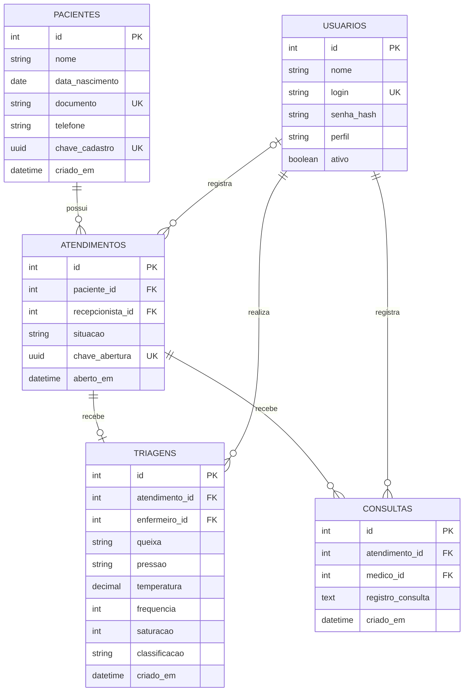

# MER — Modelo Entidade-Relacionamento

Este documento descreve o modelo conceitual atualizado conforme os fluxos e schemas atualmente
implementados. Os schemas operacionais ficam em
[database/mysql/estrutura.sql](../database/mysql/estrutura.sql) e
[database/oracle/estrutura.sql](../database/oracle/estrutura.sql). O modelo deve continuar sendo
comparado com o MER oficial aprovado pelo grupo.

## Diagrama

## Entidades e regras

### USUARIOS

Armazena as contas e os perfis de acesso.

- `id`: chave primária.
- `nome`, `login`, `senha_hash`, `perfil` e `ativo`.
- `login` é único; a senha é armazenada como hash `scrypt`.
- Os perfis válidos são `recepcao`, `enfermagem` e `medico`.
- A autorização por perfil é aplicada no backend.

### PACIENTES

Armazena os dados cadastrais do paciente.

- `id`: chave primária.
- `nome`, `data_nascimento`, `documento`, `telefone`, `chave_cadastro` e `criado_em`.
- `documento` contém os 11 dígitos do CPF e é único; `telefone` é opcional.
- `chave_cadastro` identifica a tentativa de cadastro e evita duplicação por repetição.

### ATENDIMENTOS

Representa uma passagem do paciente pelo fluxo de atendimento.

- `id`: chave primária; `paciente_id`: referência obrigatória a `PACIENTES`.
- `recepcionista_id`: referência opcional a `USUARIOS`.
- `situacao`: `aguardando_triagem`, `aguardando_medico`, `em_atendimento` ou `finalizado`.
- `chave_abertura`: identificador único da tentativa; `aberto_em`: data/hora de abertura.
- O schema também impede mais de um atendimento não finalizado para o mesmo paciente. A
  implementação física usa uma coluna gerada no MySQL e um índice baseado em função no Oracle.

### TRIAGENS

Registra a avaliação de enfermagem vinculada ao atendimento.

- `id`: chave primária; `atendimento_id`: referência única a `ATENDIMENTOS`.
- `enfermeiro_id`: referência a `USUARIOS`.
- `queixa`, `pressao`, `temperatura`, `frequencia`, `saturacao`, `classificacao` e `criado_em`.
- A restrição única de `atendimento_id` estabelece no máximo uma triagem por atendimento.
- As classificações aceitas são `Vermelho`, `Laranja`, `Amarelo`, `Verde` e `Azul`.
- A enfermagem informa a classificação; o sistema não a calcula.

### CONSULTAS

Registra os apontamentos textuais feitos pelo médico.

- `id`: chave primária; `atendimento_id`: referência a `ATENDIMENTOS`.
- `medico_id`: referência a `USUARIOS`; `registro_consulta`: texto obrigatório;
  `criado_em`: data/hora gerada pelo banco.
- Um atendimento pode ter vários registros de consulta.
- O modelo aprovado para esta etapa não possui colunas `paciente_id` ou `triagem_id` em
  `CONSULTAS`. Antes de gravar, o backend valida que o paciente e a triagem selecionados pertencem
  ao atendimento indicado.

## Cardinalidades

| Relação                  | Cardinalidade                  | Regra                                                                                                |
| ------------------------ | ------------------------------ | ---------------------------------------------------------------------------------------------------- |
| PACIENTES — ATENDIMENTOS | 1:N                            | Cada atendimento pertence a um paciente; um paciente pode ter vários atendimentos ao longo do tempo. |
| USUARIOS — ATENDIMENTOS  | 1:N, com participação opcional | Um atendimento pode não ter recepcionista; cada recepcionista pode abrir vários atendimentos.        |
| ATENDIMENTOS — TRIAGENS  | 1:0..1                         | Um atendimento pode ainda não ter triagem ou ter exatamente uma.                                     |
| USUARIOS — TRIAGENS      | 1:N                            | Cada triagem tem um profissional responsável; um profissional pode realizar várias triagens.         |
| ATENDIMENTOS — CONSULTAS | 1:N                            | Um atendimento pode ter nenhuma ou várias consultas; cada consulta pertence a um atendimento.        |
| USUARIOS — CONSULTAS     | 1:N                            | Cada consulta é registrada por um médico autenticado; um médico pode registrar várias consultas.     |

## Compatibilidade física

O modelo conceitual é o mesmo nos dois SGBDs, embora os tipos físicos variem: por exemplo, Oracle
usa `NUMBER`, `VARCHAR2` e `CLOB`, enquanto MySQL usa `INT`, `VARCHAR` e `TEXT`. Os schemas de
execução são os arquivos específicos do motor ligados acima. A tabela de medicações e as operações
de encerramento não fazem parte do modelo implementado nesta etapa.
